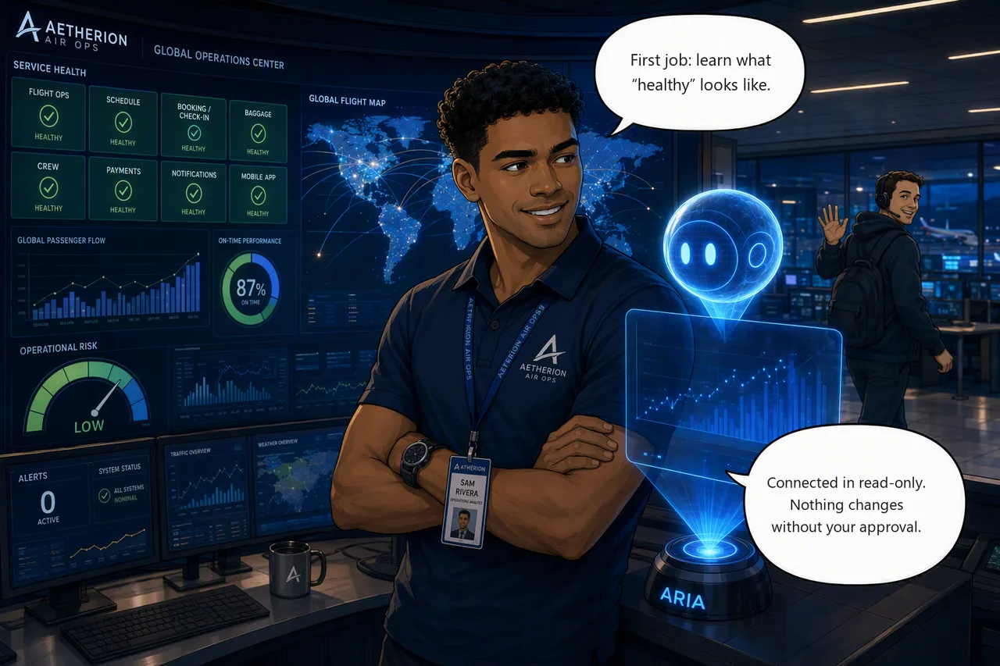

# Challenge 1 · Onboard the Agent and Establish the Baseline

!!! abstract "Challenge 01 of 06 · Act I: Foundation"
    **Time:** ~45 min · **Run mode:** Review · **Access:** your resource group only

**Situation.** You are **Sam Rivera**, on your first shift as a reliability engineer at
Aetherion AirOps. Every tile is green. Beside you is **Aria**, the Azure SRE Agent: a new
teammate with no access to anything yet.

**Mission.** Create the agent on the **Azure OpenAI** model provider, scope it to your resource
group in Review mode, capture a healthy baseline, and schedule a daily health check.

*New here? [Meet Aetherion](../getting-started/overview.md) takes two minutes.*

!!! example "Start this challenge"

    ```powershell
    ./scripts/start-challenge.ps1 1
    ```

    No fault is injected. If the Operations Center is not all green, run
    `./scripts/reset-environment.ps1` and wait a few minutes before you capture a baseline.

!!! danger "Model provider: select Azure OpenAI (GPT / ChatGPT). Never Anthropic."
    Regulatory requirement. The create wizard labels **Azure OpenAI** as *Covered by EU Data Boundary
    commitments*. **Anthropic** is labelled *Excluded from EU Data Boundary* (data may be processed in the
    United States) even though the wizard badges it **Preferred**. Azure OpenAI is preselected: leave it. Check the label before you click **Next**. You can see and change the provider later in the
    agent's settings, so confirm it there too.

### Tasks

1. **Check the board.** Read the Operations Center while it is green. That is your reference for the day.
2. **Confirm telemetry.** Open Grafana and check that AKS and Application Insights are reporting.
3. **Create the agent.** In **your** resource group, on **Azure OpenAI**, in **Review** mode. Give it read access to your code, logs and resource group.
4. **Capture the baseline.** Ask the agent for a baseline of the `aetherion` namespace, then spot-check its numbers.
5. **Schedule it.** Have the agent re-run that check every morning so drift shows up early.

{ .story-panel loading=lazy }

### Suggested prompt

!!! quote "Paste into the agent chat"
    Generate an operational baseline for the `aetherion` namespace: running services and ready
    replicas; dependencies (PostgreSQL, Redis, what sits behind the API); normal latency for
    `booking` (check-in) and the flight board; and the top signals to watch. Support every
    finding with telemetry and make no changes.

### Success criteria

- All tiles are healthy and Grafana shows live metrics.
- The agent uses the **Azure OpenAI** provider, is scoped to **your** resource group only, and runs in **Review** mode.
- You hold a baseline captured while healthy, and its replica counts and latency match the Ops Center and Grafana.
- A scheduled daily health check exists.

!!! success "Verify your work"

    ```powershell
    ./scripts/check-challenge.ps1 1
    ```

    Two of the checks are yes/no questions about the connection and your baseline. Answer honestly.

??? tip "Hints"

    - Create the agent in the **same resource group** as the platform and keep it in Review mode.
    - Ask one specific question about namespace health rather than browsing pod by pod.
    - Trust measured latency; verify configuration values (CPU limits, replica counts) yourself.

??? question "Stuck? Step by step"

    ??? note "Task 3 · Create the agent"
        1. Portal → **Azure SRE Agent** → **Create**. **Subscription**: the one your facilitator gave you.
           **Resource group**: **your** group (`rg-aetherion-nano-…`). **Region**: Sweden Central.
        2. **Agent name**: `aetherion-sre-agent`. It must not share its first 15 characters with your resource group name.
        3. **Application Insights**: **Create new** (the agent's own, separate from the app's).
        4. **Model provider**: choose **Azure OpenAI** and confirm it says *Covered by EU Data Boundary commitments*.
        5. **Review + create** → **Create**, then **Full setup** and connect:
            - **Code** → **GitHub** → **Your account** → add **your copy** of `aetherion-airops-platform`.
              Code Access only reads the repo, so do not spend your PAT here (it is for Challenge 6).
            - **Logs** → **Log Analytics Workspace** → the app's **`aetherion-law`** (not the agent's own `workspace…`).
            - **Azure resources** → **Resource group** → **only your** group, at **Reader**. Never *Subscription*; leave out the `MC_…` group.
        6. Leave **Incidents** and **Knowledge** for later; Challenge 4 connects Incidents.

        !!! danger "Your copy, never the lab repo"
            The lab repo holds the answers and fault scripts. The agent must only see
            `<your-account>/aetherion-airops-platform`.

        **Check it took.** Ask *"List the resources in my resource group"*, then *"Restart a deployment"*:
        in Review mode it must ask for approval, not act. Ask *"Which log sources and repositories are you
        connected to?"* It should name `aetherion-law` and your repo. If **Builder → Code Access** shows your
        repo as **Ready** and **Builder → Connectors** lists Log Analytics, you are set.

        The "won't change anything" guarantee comes from **Review mode**, not from the role being read-only.

    ??? note "Task 4 · Capture the baseline"
        Paste the prompt above with the board green. Spot-check 2 to 3 numbers (replicas, `booking` latency)
        against the tiles and Grafana. To check a configuration value:

        ```powershell
        kubectl get deploy gateway -n aetherion -o jsonpath='{.spec.template.spec.containers[0].resources}'
        ```

    ??? note "Task 5 · Schedule it"
        In the **same chat thread** as Task 4, ask:

        > Schedule this baseline to run every morning at 08:00 UTC and alert me on drift from normal.

        Include the time zone or the agent will stop and ask. You can also use **Scheduled tasks** in the portal.

### Reference

- [Create and set up the SRE Agent](https://learn.microsoft.com/en-us/azure/sre-agent/create-and-set-up)
- [Create and edit scheduled tasks](https://learn.microsoft.com/en-us/azure/sre-agent/create-scheduled-task)

!!! success "Up next: the first real symptom"
    Challenge 2 injects an incident. You will know it is abnormal because you measured normal.

    [Proceed to Challenge 2 · Detect and Investigate →](02-detect-and-investigate.md){ .md-button .md-button--primary }
