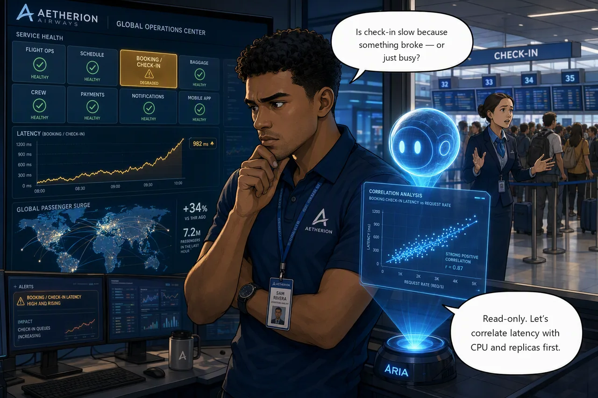

# Challenge 2 · Detect and Investigate Without Touching Production

!!! abstract "Challenge 02 of 06 · Act II: Human-Guided Operations"
    **Time:** ~40 min · **Run mode:** Review · **Access:** read-only investigation

**Situation.** Online check-in has slowed to a crawl. Requests that took milliseconds now take
seconds, and the **booking / check-in** tile has gone amber just as traffic climbs toward a
departure peak. Is check-in buckling under the surge, or did something change?

**Mission.** Confirm the slowdown from live signals and form a hypothesis for the likely cause,
backed by at least two independent signals, **without changing anything**. Challenge 3 fixes it.

!!! example "Start this challenge"

    ```powershell
    ./scripts/start-challenge.ps1 2
    ```

    Give it two or three minutes. Latency climbs from milliseconds to seconds and stays there, while
    every request still succeeds, which is itself a clue.

### Tasks

1. **Confirm the symptom.** Compare check-in latency now with your Challenge 1 baseline, using the Operations Center and Grafana.
2. **Correlate read-only.** Have the agent line up `booking` request duration against CPU, replicas, dependency calls and load.
3. **Record your hypothesis.** Capture the likely cause, the two signals behind it, and the recovery you would propose. Do not perform it.

{ .story-panel loading=lazy }

### Suggested prompt

!!! quote "Paste into the agent chat"
    Check-in has slowed to a crawl. Investigate read-only and tell me the most likely cause,
    with the evidence behind it. Change nothing.

That is deliberately thin, as it would be at 18:12. The first answer will be broad. Push back, and notice
which follow-up moves it forward: that is the skill this challenge teaches.

### Success criteria

- You have confirmed the slowdown and can name the affected service and user-facing path.
- You can name the most likely cause, backed by two independent signals, and separate the surge from **the change that caused it**.
- You made no change to production.

!!! success "Verify your work"

    ```powershell
    ./scripts/check-challenge.ps1 2
    ```

??? tip "Hints"

    - Start from the delta against your baseline, over the same time window.
    - A starved service is *busy*. This one is not: CPU is low, nothing restarted, every request succeeds. It is **waiting** on something. What does `booking` call besides its database?
    - Compare the live workload with what the repository's manifest declares. The gap is the finding.
    - Still stuck? Ask: *"Analyze the check-in path read-only. Correlate `booking` duration with CPU, replicas, dependency call durations and load over the last 30 minutes, check recent rollouts, and compare the live workload with the repository manifest. Give the most likely cause with evidence. Change nothing."*

??? question "Stuck? Step by step"

    ??? note "Task 1 · Confirm the symptom"
        Open the **Operations Center** and note the `booking` tile's p95 and error rate, then the **Grafana**
        dashboard for the same window. Compare with your baseline: milliseconds became seconds, yet nothing
        fails. A flat, elevated latency is rarely load.

    ??? note "Task 2 · Correlate read-only"
        Paste the prompt above. Look for signals that disagree: latency up while CPU, replicas and errors are
        normal. Something is being waited on, not overloaded. Then ask the agent to compare the running
        workload with the manifest in your connected repo. Stay read-only.

    ??? note "Task 3 · Record your hypothesis"
        > Summarise this investigation in under 200 words: the likely root cause, the two independent signals,
        > and the least-disruptive recovery you would propose. Do not remediate.

        Keep this chat thread open for Challenge 3, or save it with *"save this to your knowledge"*.

        !!! tip "Write down one number"
            Note how many minutes passed between `start-challenge.ps1 2` and a defensible hypothesis. You will
            compare it with the agent's speed in Challenge 5.

### Reference

- [Run a deep investigation](https://learn.microsoft.com/en-us/azure/sre-agent/deep-investigation)
- [Root cause analysis](https://learn.microsoft.com/en-us/azure/sre-agent/root-cause-analysis)

!!! success "Up next: controlled recovery"
    With a defensible hypothesis, you recover check-in under approval.

    [Proceed to Challenge 3 · Controlled Recovery →](03-controlled-recovery.md){ .md-button .md-button--primary }
