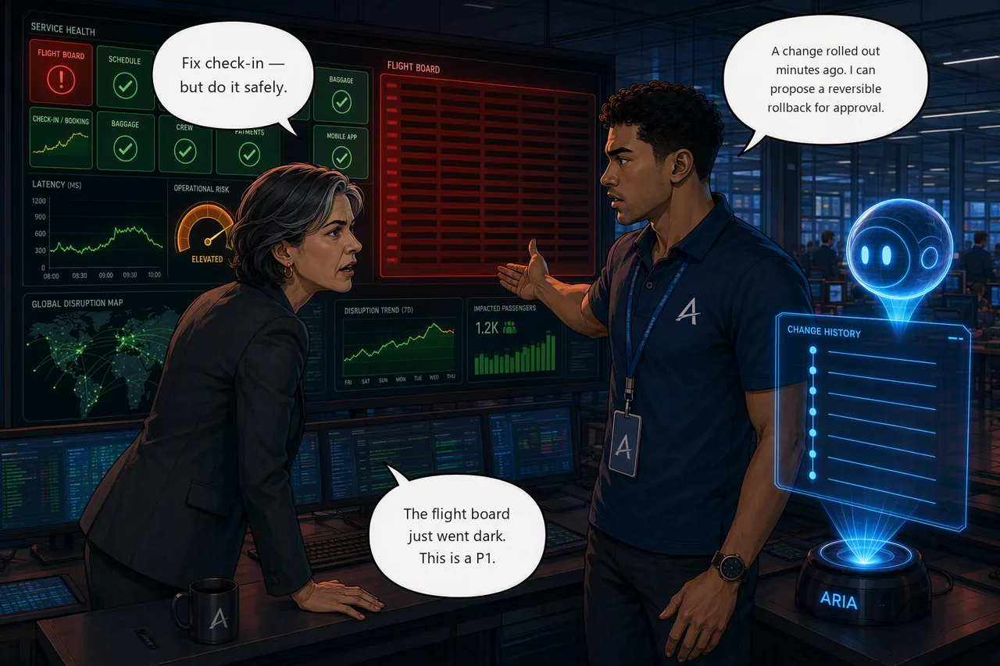

# Challenge 3 · Controlled Recovery

!!! abstract "Challenge 03 of 06 · Act II: Human-Guided Operations"
    **Run mode:** Review → approved write · **Governance:** every action approved by you

    **Time:** ~25 min

    **Stage:** Foundation → **Operations** → Autonomous → Major Incident

**Situation.** Your check-in hypothesis from Challenge 2 is solid and
**Elena Vasquez**, Aetherion's operations director, wants it fixed **safely**,
with a human in the loop. The incident is still open, so now you recover it.

**Mission.** Recover check-in with the least-disruptive action under human approval,
and verify it from telemetry.

!!! example "Start this challenge"

    ```powershell
    ./scripts/start-challenge.ps1 3   # continues the open check-in incident
    ```

    Challenge 2 already opened this incident, so starting Challenge 3 does not add
    a new fault.

### Tasks

1. **Plan the fix.** Ask the agent to turn your hypothesis into a concrete `booking` remediation plan and name the permission it needs.
2. **Recover under approval.** Keep the agent in Review, approve the least-disruptive fix, then confirm latency is back to baseline.

{ .story-panel loading=lazy }

### Suggested Azure SRE Agent prompt

!!! quote "Paste into the agent chat"
    Check-in is still slow. Propose a fix. Don't change anything yet.

Whatever it comes back with, make it name the permission each action needs before
you let it near production.

### Success criteria

- Check-in is remediated with a least-disruptive action you approved in **Review** mode (not ungoverned automation); `booking` is healthy, latency is back to baseline, and **the setting the change altered matches what the repository declares**. Compensating around it is not a fix.
- `check-challenge.ps1 3` passes.

!!! success "Verify your work"

    Run this when you're done. It grades the real end state:

    ```powershell
    ./scripts/check-challenge.ps1 3
    ```

??? tip "Hints"

    **Recover check-in safely.** Ask the agent for a remediation *plan* before any
    action. The plan names the permission the write needs, and it is what you are
    approving.

    The safe fix puts back exactly what the last change took away, rather than a value
    someone picks now. It shouldn't need to restart the cache, touch the database, or
    go near the nodes.

    **How an experienced operator would have scoped it.** If the agent is wandering,
    this is how someone who has done this before would ask:

    > Turn my check-in hypothesis into a concrete remediation plan for the `booking`
    > service. Restore it to exactly what the repository's manifest declares rather
    > than to a value you choose, and tell me exactly what permission the action
    > needs.

    Note what it refuses to leave open: *restore to what the repository declares, not
    a value you choose*. Compensating around a bad change looks like a fix and isn't.

    Not every change arrives through git. This one was applied straight to the cluster,
    so the rollout history *is* the change record, which is exactly why teams insist
    changes go through a pipeline that leaves one.

??? question "Stuck? Step-by-step for each task"
    Give each task a genuine attempt first, and skim the hints above. When you want
    the exact clicks, open the matching task below.

    ??? note "Task 1 · Plan the fix"
        - In the agent chat, paste the **suggested prompt** above (or ask it to turn
          your check-in hypothesis into a concrete `booking` remediation plan).
        - Read what it proposes: it should say exactly what it will change and the
          **permission** the action needs. That is what you are about to approve.

        !!! warning "A plan is not a pending action"
            The agent will write you a plan and then stop, and no **Approve** button
            appears. That is correct behaviour, not a broken setup: in Review mode
            the approval card only appears when the agent **attempts a write**. Read
            commands run on their own; nothing is queued until you say so.

            When you're happy with the plan, tell it to go:

            > Apply the booking remediation now.

            The approval appears then. The agent may also describe a plan as
            "ready for approval" while nothing is actually queued, so treat that
            phrasing as "I've finished thinking", not "your turn to click".

    ??? note "Task 2 · Recover under approval"
        - Keep the agent in **Review**. When the approval card appears, read the exact
          command on it, then select **Approve action**: it runs once, and the action
          is recorded.
        - Note *what* gated that write. The recovery is a Kubernetes operation, so it
          was your **run mode** that held it for approval, not the agent's Azure role.
          Permissions decide what the agent can reach; run mode decides whether it
          asks first.

        !!! note "Read the small print on the approval card"
            It says **"Agent permissions will be used to complete this action."**
            The write runs as the agent's own managed identity, not as you. So the
            change is attributed in the Activity Log to the agent, not to the person
            who approved it. Worth remembering in Challenge 6, when you're asked to
            produce change evidence and explain who did what.

        One instruction queues **one** action: approving the check-in fix queues
        nothing else.

        Then verify `booking` latency is back to baseline, and confirm the change was
        actually reverted rather than worked around. The running configuration
        should match what the repository's manifest declares, with no leftover
        override on the deployment.

        !!! note "Check the change record afterwards"
            Run `kubectl rollout history deploy/booking -n aetherion` once check-in
            is fixed. The revision that *caused* the incident and the revision that
            *fixed* it carry the same change cause, because the remediation didn't
            set a new one.

            Nothing is broken. It's what happens when a fix is applied without
            recording why, and it's the reason your change log stops being evidence.
            You'll want this in the Challenge 6 handover.

        !!! tip "Optional · ask it to draw what it just told you"
            Once check-in is back, try:

            > Visualize this incident as a diagram: the timeline, the causal chain
            > from the change to the slowdown, and the request path a passenger hit.

            The agent writes the image in its Python sandbox and hands it back. It
            takes seconds, and it is the artefact that works on a bridge call: the
            people who join late understand the shape of the incident without
            reading a single line of your investigation.

            You will render a formal PDF in Challenge 6. This is the version you
            produce **while the incident is still open**, which is usually when it
            is worth the most.

### Reference

- [Review and approve mitigations](https://learn.microsoft.com/en-us/azure/sre-agent/execute-mitigations)
- [Manage roles and permissions](https://learn.microsoft.com/en-us/azure/sre-agent/manage-permissions)
- [Connect source code](https://learn.microsoft.com/en-us/azure/sre-agent/connect-source-code)

!!! success "Up next: let the agent act on its own"
    Every write so far waited for your approval. Next, a minor incident is safe enough to hand to the agent.

    [Proceed to Challenge 4 · Autonomous Recovery →](04-autonomous-recovery.md){ .md-button .md-button--primary }

---
