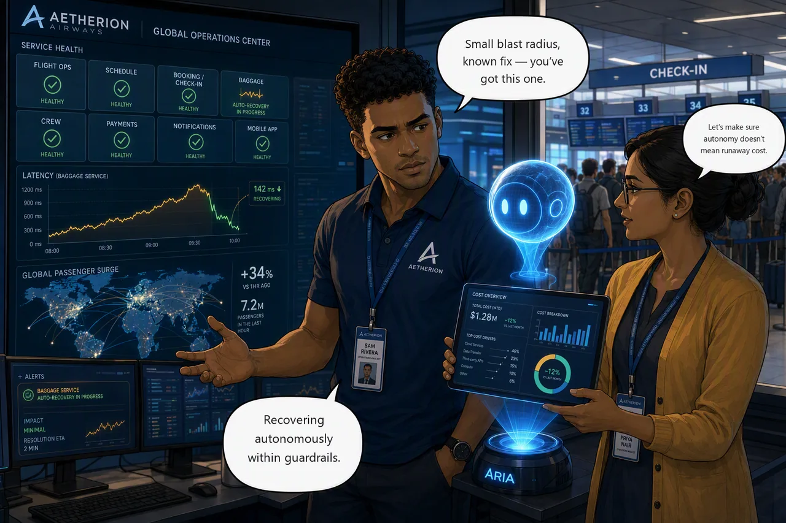

# Challenge 4 · Autonomous Recovery and Sev1 Plan

!!! abstract "Challenge 04 of 06 · Act III: Autonomous"
    **Time:** ~30 min (+15 optional cost tasks) · **Run mode:** Autonomous, bounded · **Access:** no per-action approval

**Situation.** Every write so far waited for your approval. Now a minor issue appears: the **baggage**
service returns errors to a slice of traffic. Bags still move, no flight is grounded, and the fix is one
you have already seen. That is exactly when it is safe to let the agent act **autonomously** while you
supervise.

**Mission.** Let the agent recover baggage on its own within guardrails, then arm a **Sev1 response plan
for your own alert**, so the next major incident triggers your agent before you reach Challenge 5.

!!! example "Start this challenge"

    ```powershell
    ./scripts/start-challenge.ps1 4
    ```

    Give it a couple of minutes. The errors show once enough traffic has hit the affected slice.
    The script prints **your alert name**. Keep it: you need it in Task 4.

!!! danger "Your alert name is unique to you. Your plan must filter on it."
    Everyone in this subscription has a look-alike Sev1 alert, and **each agent scans every alert in the
    subscription**. A plan filtered only on *Sev1* reacts to other attendees' alerts, and theirs react to
    yours, so an agent can take (and acknowledge) someone else's incident. Your plan must set
    **Title contains** to **your exact alert name**. Find it with:

    ```powershell
    (Get-Content ./scripts/.env.aetherion.json | ConvertFrom-Json).incidentAlertName
    ```

    It looks like `aetherion-major-incident-a1b2c3`. It is also in the portal under **Monitor → Alerts →
    Alert rules**, in your resource group.

!!! note "Your Sev1 alert may fire during this challenge"
    The baggage errors count as failed requests, so your alert can fire here too. If your agent opens a
    [Sev1] thread for it after you arm the plan, that is expected. Challenge 5 waits for it to clear before it starts.

### Tasks

1. **Confirm the symptom.** Verify the baggage errors in the Ops Center and telemetry, so you know what "recovered" looks like.
2. **Decide the bounds, then hand over.** Judge whether this incident is safe to automate, switch to **Autonomous**, let the agent fix it end to end, then review its action log.
3. **Connect Azure Monitor.** In **Incidents**, connect Azure Monitor as the incident platform (the default is PagerDuty, so switch it). Delete any default plan it creates.
4. **Arm the Sev1 plan on your alert.** Severity **Sev1**, **Title contains** = your alert name, Autonomous, subagent left on **Meta Agent**, cooldown off. **Challenge 5 does not work without this.**

{ .story-panel loading=lazy }

### Suggested prompt

!!! quote "Paste into the agent chat"
    The `baggage` service is returning intermittent errors to a slice of traffic while other requests
    succeed. Detect the fault, decide the sanctioned reversible fix, apply it autonomously, and report
    exactly what you changed and why it was safe to automate.

### Success criteria

- The agent fixed baggage autonomously, the service is healthy, and you can say why it was safe to automate: small blast radius, a reversible remedy, degraded rather than down, and a run mode you chose deliberately.
- One enabled **Sev1** plan exists, with **Title contains** set to **your alert name**, Autonomous, subagent left on **Meta Agent**, and cooldown disabled. It is the only plan.

!!! success "Verify your work"

    ```powershell
    ./scripts/check-challenge.ps1 4
    ```

    It grades the end state, then walks your plan setting by setting. A plan that looks right but never fires
    is the one failure you would not see until Challenge 5 is open.

??? tip "Hints"

    - What makes this safe to automate is the *shape* of the incident, not a permission setting. Decide that **before** you switch mode, then resist helping.
    - Set the plan severity to **Sev1** exactly, and **Title contains** to your full alert name. Anything broader catches other people's alerts; anything narrower misses yours.
    - Leave **Response subagent** on **Meta Agent** so the main agent commands the whole board in Challenge 5.

??? question "Stuck? Step by step"

    ??? note "Task 1 · Confirm the symptom"
        Check the **baggage** tile and Application Insights failed requests. Some requests succeed and some fail:
        ask the agent what is different about the failing ones. The answer is behind the Service, not in it.
        `kubectl get pods -n aetherion -l app=baggage --show-labels` shows the same.

    ??? note "Task 2 · Decide the bounds, then hand over"
        Write down what the agent may change, what it must never touch, and how you would undo it. Set the run
        mode to **Autonomous**, let it detect, decide and fix, then review the action log.

        !!! note "\"Never delete\" means data, not a bad revision"
            The guardrails forbid deleting **data resources** (databases, caches, storage). Removing a workload
            revision that should not be serving is an ordinary, reversible rollback and the sanctioned fix.

    ??? note "Task 3 · Connect Azure Monitor"
        1. **Incidents** → **Connect platform** → choose **Azure Monitor** (PagerDuty is preselected) → **Save**.
        2. Open **Triggers & response plans**. If a default **quickstart** plan exists, **delete it**: left in place
           it runs alongside yours and can route an incident to the wrong place or process it twice.

        !!! warning "If an orange banner says the identity lacks Monitoring Contributor at subscription scope"
            Azure Monitor still connects, but the portal can only grant the role on your resource group, and the agent
            needs it on the **subscription** to scan alerts. Do not click **Assign Monitoring Contributor role**: you
            only own your resource group. Tell your proctor, who runs a script that grants it. Alerts are not processed
            until they have.

    ??? note "Task 4 · Arm the Sev1 plan on your alert"
        **Create a response plan**:

        | Field | Value |
        |---|---|
        | Plan name | `aetherion-major-incident-sev1` |
        | **Severity** | **Sev1** |
        | **Title contains** | **your exact alert name** (for example `aetherion-major-incident-a1b2c3`) |
        | Title does not contain | leave empty |
        | **Response subagent** | leave on **Meta Agent** (the default) |
        | **Agent autonomy level** | **Autonomous** |
        | **Alert reinvestigation cooldown** | **disable** (it defaults to 3 hours and would silently block a re-run) |

        Then **Next** (it previews the incidents your filter matches) and **Create**. The thread title will read `[Sev1] <your alert name>`.

    ??? note "Optional · Where do the AAUs go?"
        Open **Settings → Agent Consumption**, note the two largest consumers with real figures, then ask:

        > Using my consumption figures, draft a cost-aware operating model as a table: each row a named lever,
        > what it saves, and what it costs in reliability or investigation quality. End with the floor we will
        > not go below. Use only my figures; invent no numbers.

        Aim for three levers with a trade-off each, and an explicit reliability floor. Cheapest is not the target.
        Not graded; useful for the Challenge 6 briefing. Use only
        [official pricing](https://learn.microsoft.com/en-us/azure/sre-agent/pricing-billing): do not claim that
        stopping an agent ends all billing.

### Reference

- [Incident response plans](https://learn.microsoft.com/en-us/azure/sre-agent/incident-response-plans)
- [Azure Monitor alerts](https://sre.azure.com/docs/capabilities/azure-monitor-alerts)

!!! success "Up next: the major incident"
    Your plan is armed on your alert. In Challenge 5 several services fail at once, and your agent is already
    acting when you arrive.

    [Proceed to Challenge 5 · Final Major Incident →](05-major-incident.md){ .md-button .md-button--primary }
