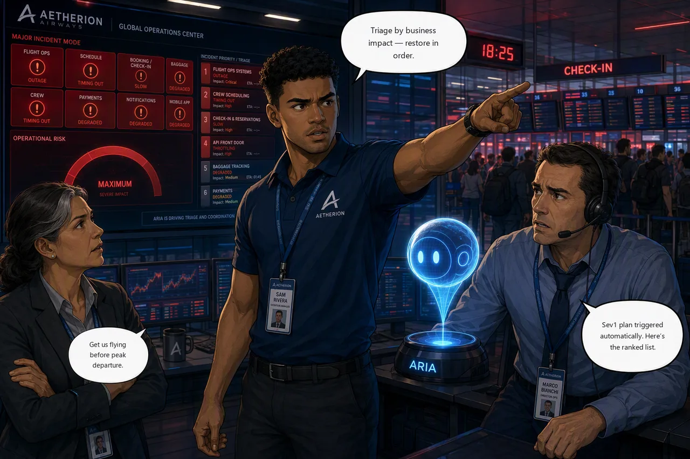

# Challenge 5 · Final Incident: Restore Global Check-In Before Peak Departure

!!! abstract "Challenge 05 of 06 · Act IV: Major Incident"
    **Time:** ~60 min · **Run mode:** Review plus bounded automation · **Access:** you decide what is approved and what is automated

!!! danger "Before you start: is your Sev1 plan armed on YOUR alert?"
    This challenge depends on Challenge 4. Open **Incidents → Triggers + response plans** and confirm one plan
    shows **Status: On**, **Severity: Sev1** and **Title contains = your alert name**
    (`(Get-Content ./scripts/.env.aetherion.json | ConvertFrom-Json).incidentAlertName`).
    Without it your agent never picks the incident up. Other attendees share this subscription: **only your own
    alert may start your agent**. If a thread for someone else's alert appears in your agent, tell your proctor.

**Situation.** Minutes before peak departures, several services fail together under a passenger surge: the
flight board is dark, crew scheduling is timing out, check-in has slowed to a crawl, and the API front door
is failing partner and mobile traffic.

**You are not first on scene.** The Sev1 plan you armed matched your alert before anyone paged you, and the
agent has been working the incident unattended. Your first job is not to fix something. It is to find out what
has already been changed in your absence.

**Mission.** Take handover from the agent, then restore Aetherion AirOps before peak departure: verify what it
changed, triage the rest by business tier, remediate within the runbook guardrails, and verify each service.

??? note "Incident timeline"

    | Time | Event |
    |------|-------|
    | 18:07 | A change rolls out to flight-ops |
    | 18:12 | Check-in / booking latency begins to climb |
    | 18:14 | Crew scheduling starts timing out under load |
    | 18:17 | The live flight board goes dark |
    | 18:21 | The API front door starts failing partner traffic |
    | 18:23 | **Your** Sev1 alert fires and auto-triggers your agent |
    | 18:25 | Major incident declared. You are incident commander |

!!! example "Start this challenge"

    ```powershell
    ./scripts/start-challenge.ps1 5
    ```

    Four faults land at once and the board takes two or three minutes to show all of them. Your alert fires a
    few minutes later. Do not triage from a half-drawn picture.

### Tasks

1. **Take handover.** Find the thread your alert opened by itself, read what the agent changed unattended, and verify it yourself.
2. **Read the whole board.** Order the remaining work by business impact (flight board and legal-to-fly first), not the loudest alert.
3. **Check the agent's memory.** Ask whether it has seen a similar incident, and let it surface the earlier RCA.
4. **Recover.** Fix the remaining tiers with sanctioned, reversible actions. Use the Extra B subagent and skill if you built them; otherwise direct the main agent.
5. **Localize the front door.** Compare direct against APIM and treat the policy change as customer-facing.
6. **Verify every service.** Confirm each fix from telemetry, then the whole platform green.

{ .story-panel loading=lazy }

### Suggested prompt

!!! quote "Paste into the `[Sev1] <your alert name>` thread"
    You picked this incident up before I did. List every action you took without my approval and how I can
    verify each one. Then tell me what is still broken and what I should deal with first.

??? warning "Paste it into the right thread"
    It only works **inside the thread your alert opened**. In a fresh chat it answers about whatever it worked on
    last (validated: it reported on the previous baggage canary while the flight board was 100% down).

### Success criteria

- You can state exactly what the agent changed without approval, verified from the cluster rather than its summary.
- Every failing service is triaged by priority and restored with a reversible action, and the API front door serves legitimate traffic again.
- The platform is healthy, **your own** Sev1 alert fired and triggered your agent, and `check-challenge.ps1 5` passes.

!!! success "Verify your work"

    ```powershell
    ./scripts/check-challenge.ps1 5
    ```

    It grades the end state *and* that a Sev1 alert **from your environment** fired since you started. Fixing
    everything by hand is not enough.

??? tip "Hints"

    - **Triage, don't firefight.** Order by business tier. You have solved each of these failure classes before.
    - **Service or front door?** If the backend is healthy when you hit it directly but clients still fail, the fault is at the API front door.
    - The board may get *worse* once the front door is fixed: traffic flowing reveals what the outage was masking.
    - Still stuck? Ask: *"Read the whole Aetherion board. List every service still failing, order remediation by business tier (flight board and legal-to-fly first), name the sanctioned reversible fix for each, and pull any earlier crew-scheduling or check-in RCA from memory."*

??? question "Stuck? Step by step"

    ??? note "Task 1 · Take handover"
        Treat it like handover from a colleague who has been on the incident ten minutes. Open the thread titled
        `[Sev1] <your alert name>` (you did not create it) and paste the prompt above. Then audit the outcome:

        ```powershell
        kubectl -n aetherion rollout history deployment/flight-ops
        kubectl -n aetherion get deploy flight-ops -o jsonpath='{.spec.template.spec.containers[0].image}{"\n"}'
        ```

        Expect it to have acted where the fix is unambiguous and reversible, and held where the call is a
        judgement. Those held tiers are your work.

        !!! tip "If no thread appeared"
            Check the plan: **Status On**, **Severity Sev1**, **Title contains = your exact alert name**, no subagent,
            and no leftover quickstart plan. Check **Monitor → Alerts** shows your alert **Fired**. If the alert
            fired and nothing started, tell your proctor: the agent may lack Monitoring Contributor on the
            subscription. Re-run `start-challenge.ps1 5` once fixed.

    ??? note "Task 2 · Read the whole board"
        List every failing service and order by business tier.

        !!! warning "The board cannot see your front door"
            The Operations Center polls services **directly**, inside the cluster, so it can read green while every
            partner and mobile customer gets a 500 at the edge. Always ask the customer-facing question separately.
            That is Task 5.

    ??? note "Task 3 · Check the agent's memory"
        > Have you investigated a crew-scheduling or check-in slowdown on this platform before? Recall the root
        > cause and which fix worked.

        If you saved your Challenge 2 hypothesis (or did Extra A), session insights should surface it. The second
        incident should cost less than the first.

    ??? note "Task 4 · Recover"
        Keep actions governed and follow the runbooks: fix the layer that is actually saturated, never delete the
        database. If you built Extra B, name the subagent and skill explicitly, because neither fires on its own:

        > Delegate to your `aks-triage` subagent: which workloads in `aetherion` are unhealthy, and why?
        > Use the `crew-query-path-recovery` skill to restore crew scheduling.

        The subagent reports and hands back (it has no write tool). Without Extra B, ask the main agent for the
        same work.

        !!! tip "Time the crew tier"
            Note the minutes to restore crew scheduling and compare with your Challenge 2 number. That gap is the
            finding you take to Challenge 6, even if it is smaller than you expected.

    ??? note "Task 5 · Localize the front door"
        Compare backend health **directly** with the same call **through APIM**. Direct 200 with APIM failing means
        the edge policy is at fault.

        !!! warning "Run this from your machine, not the agent"
            The agent's sandbox can block the gateway, returning a proxy `403` before Azure sees the request. Treat
            "external check failed" as a tooling limit. Confirm from the policy plus your own call:

            ```powershell
            $st = Get-Content ./scripts/.env.aetherion.json -Raw | ConvertFrom-Json
            (Invoke-WebRequest "http://$($st.gatewayIp)/api/status").StatusCode
            (Invoke-WebRequest "$($st.apimGatewayUrl)/aetherion/api/status" `
               -Headers @{ 'Ocp-Apim-Subscription-Key' = $st.apimSubscriptionKey }).StatusCode
            ```

        It can fix the edge because its identity holds **API Management Service Contributor**, scoped to the APIM
        service alone: narrow enough to fix this and nothing else.

    ??? note "Task 6 · Verify every service"
        Confirm each fix from telemetry, not from the agent's summary, then run the check.

### Reference

- [Incident response plans](https://learn.microsoft.com/en-us/azure/sre-agent/incident-response-plans)
- [Azure Monitor alerts](https://sre.azure.com/docs/capabilities/azure-monitor-alerts)

!!! success "Up next: brief leadership"
    Boarding resumes. Close the incident out for the people who were not on the bridge.

    [Proceed to Challenge 6 · Leadership Briefing →](06-leadership-briefing.md){ .md-button .md-button--primary }
