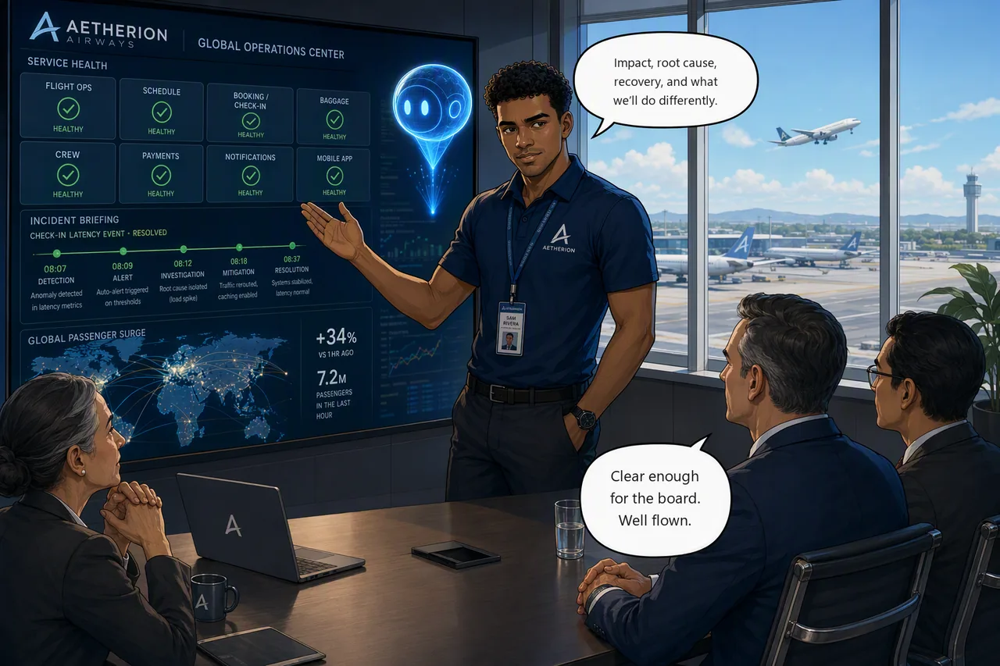

# Challenge 6 · Boarding Resumes: Brief Airline Leadership

!!! abstract "Challenge 06 of 06 · Act IV: Major Incident"
    **Time:** ~25 min core (+20 min stretch) · **Run mode:** Review · **Access:** read-only summarization, plus governed writes to your repo

**Situation.** The platform is stable and the peak departure bank is away safely. A major incident is not
closed when the tiles go green. It is closed when leadership understands it and the team has captured what
to do differently.

**Mission.** Produce a concise leadership briefing, an engineering RCA handover that separates symptom,
root cause, mitigation and remaining risk, and a downloadable PDF of the briefing. *Stretch:* publish the RCA
back to your repository.

!!! example "Start this challenge"

    ```powershell
    ./scripts/start-challenge.ps1 6
    ```

    No fault is injected, so the platform stays green while you write.

### Tasks

1. **Assemble the evidence.** Build one defensible narrative from what you preserved during the shift.
2. **Write the leadership briefing.** Short, impact-first and non-technical, for the operations director.
3. **Write the engineering RCA handover.** Exact actions, how each was verified, open risks and change evidence.
4. **Generate the PDF.** Have the agent render the briefing, with a timeline chart, in its Python sandbox.
5. **Stretch · File the RCA as an issue** on your repo with the GitHub Connector.
6. **Stretch · Open a pull request** that fixes the runbook that failed you, through the GitHub MCP server.

*Tasks 5 and 6 need the GitHub token you created during setup. If time is short, finish 1 to 4.*

{ .story-panel loading=lazy }

### Suggested prompt

!!! quote "Paste into the agent chat"
    From today's preserved evidence, draft two separate artifacts: (1) a concise, impact-first **leadership
    briefing** (business impact, root cause, recovery, risk, lessons) and (2) an **engineering RCA handover**
    (actions taken, how each was verified, open risks, and change evidence: rollout history with change causes,
    and the Azure Activity Log for the API Management policy change). Then render the briefing as a **PDF** with
    an incident-timeline chart using your Python sandbox.

### Success criteria

- The platform is healthy at close.
- The briefing covers impact, root cause, recovery, risk and lessons. The RCA separates symptom, root cause, mitigation and permanent fix, with change evidence from rollout history and the Activity Log.
- The agent produced a **downloadable PDF** with a timeline chart.
- *Stretch:* the RCA exists as an issue on **your** repo, and a pull request improves the runbook that failed in Challenge 5.

!!! success "Verify your work"

    ```powershell
    ./scripts/check-challenge.ps1 6
    ```

    Platform health is graded. The briefing is yours to attest to, and the issue and pull request are checked
    on your repo if you did the stretch.

??? tip "Hints"

    - Start from the evidence you preserved, not memory. Write two documents: leadership wants impact; the next on-call wants exact actions and open risks.
    - Feed the lessons back into the agent's memory, then get them out of the agent entirely: a record in one agent's memory is still a single point of failure.

??? question "Stuck? Step by step"

    ??? note "Task 2 · Leadership briefing"
        > Write a briefing for the operations director about today's major incident. Lead with business impact.
        > Cover what passengers experienced and for how long, the root cause in plain language, how we recovered,
        > the cost and residual risk, and the lessons. Under one page, no Kubernetes jargon.

        If a sentence needs an engineer to translate it, send it back.

        !!! tip "Answer \"what did this buy us?\""
            Add your two numbers yourself, because the agent cannot know them: minutes to a hypothesis in
            Challenge 2 (cold) against minutes to recover the crew tier in Challenge 5. State the difference plainly and
            say it is one day's sample from one team, not a benchmark.

    ??? note "Task 3 · Engineering RCA"
        > Write an engineering RCA handover for the next on-call: every action taken and how it was verified, the
        > remaining risk, and the change-correlation evidence with exact sources.

        Workload changes live in **rollout history** (`kubectl rollout history deploy/<svc> -n aetherion`). The API
        Management policy change is in the **Azure Activity Log** as `Set Product policy configuration`. In-cluster
        changes never reach the Activity Log, which is itself a gap worth stating. If the agent finds nothing, ask it
        to query the Activity Log at **subscription scope**.

    ??? note "Task 4 · PDF"
        > Render the leadership briefing as a formatted PDF, including an incident timeline chart, using your
        > Python sandbox. Give me a download link.

        If the download fails, ask it to list the file and give the link again: the first link can expire.

    ??? note "Task 5 · File the RCA as an issue (stretch)"
        Code Access (Challenge 1) lets the agent **read** your repo. Writing needs the **GitHub Connector**.

        1. **Builder → Connectors → Add connector → GitHub**. Authenticate with OAuth or a fine-grained PAT with
           **Issues** and **Pull requests**: Read and write. Select **your** copy of `aetherion-airops-platform`.
        2. Ask:

            > Publish the engineering RCA as a GitHub issue on `https://github.com/<your-account>/aetherion-airops-platform`.
            > Title it `RCA: major incident - global check-in degradation`. Include the timeline, root cause per
            > service, every action and how it was verified, and a checklist of corrective actions. Label it `incident`.

        3. In Review mode you approve the write. Read it first: it goes into a repository with your name on it.

        !!! warning "\"No writes\" is a tool boundary, not a permission boundary"
            Code Access leaves an OAuth credential in the sandbox clone. In **Autonomous** mode an agent with only
            Code Access has been seen reading it and filing the issue with `gh api`. What holds the line is **run
            mode and approvals**. Use the connector anyway: it is the governed, auditable path.

        Issues work because you made your repo from a **template** (forks have Issues disabled). Filing an issue
        records what happened; it does not change what happens next. For that you need a file change, which the
        connector cannot make because it only opens a PR between branches that already exist. That is Task 6.

    ??? note "Task 6 · Open the pull request (stretch)"
        1. **Builder → Connectors → Add connector → GitHub (MCP)**. Transport **Streamable-HTTP**, URL prefilled,
           auth with your **PAT** (no OAuth option here).
        2. The token must allow: **Contents**, **Pull requests**, **Issues**, all Read and write, with *Only select
           repositories* set to your private copy. A read-only token **connects fine and then fails on the first
           write**, which looks like a broken connector.
        3. A **Select tools** step lists everything the server exposes. You have **80 tools in total** per agent,
           shared with native tools. Take only what you need, or you will degrade tool selection.
        4. Ask the agent to branch, commit and open a PR that fixes the runbook that failed in Challenge 5.

        In an organisation, a fine-grained token may need **owner approval** before it works.

### Reference

- [Connect source code](https://learn.microsoft.com/en-us/azure/sre-agent/connect-source-code)
- [Model Context Protocol connectors](https://learn.microsoft.com/en-us/azure/sre-agent/mcp-connectors)

!!! success "🎉 NanoHack complete: you built an AI SRE teammate from scratch"
    You onboarded a read-only agent, recovered an incident under approval, let the agent act on its own, commanded a
    major incident it had already started, and briefed leadership.

    [Finish →](finish.md){ .md-button .md-button--primary }
