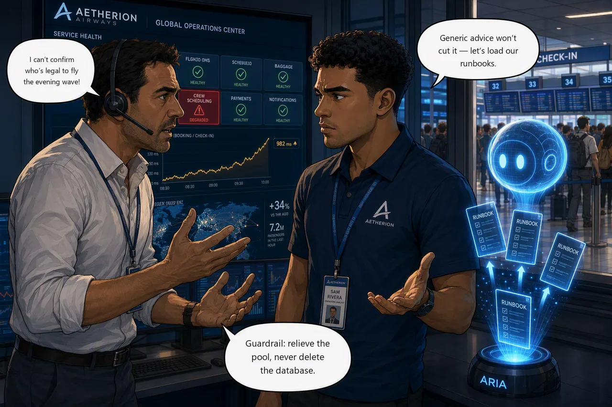

# Extra A · Give the Agent Aetherion's Operational Knowledge

!!! abstract "Extra A · Optional extra"
    **Time:** ~40 min · **Run mode:** Review, approved writes · **Access:** every action approved by you

    Do this if you finish early. Nothing later depends on it.

**Situation.** Crew scheduling is failing and **Marco Bianchi** on the crew desk cannot confirm who is legal to
fly the evening wave. Services that share its database are wobbling too, so "the database is down" is the
obvious call, and it is wrong. Out of the box the agent gives generic advice, and "restart the database" is
exactly what Aetherion's runbooks forbid.

**Mission.** Ground the agent in Aetherion's runbooks so it recommends the sanctioned fix, then recover
`crew-scheduling` with that non-destructive remediation.

!!! example "Start this challenge"

    ```powershell
    ./scripts/start-challenge.ps1 A
    ```

    Crew scheduling degrades in two or three minutes and its neighbours follow. Read the whole board before you
    draw the blast radius.

### Tasks

1. **Find the origin.** Work out which service *causes* the database pressure and which merely share the damage.
2. **Ground the agent.** Load the `knowledge/` runbooks, then re-ask and watch the advice change.
3. **Apply the sanctioned fix.** Repair the query path the runbook points to (never delete the database) and confirm crew recovers.

{ .story-panel loading=lazy }

### Suggested prompt

Ask this **before** you load anything, so you have something to compare against.

!!! quote "Paste into the agent chat, ungrounded"
    `crew-scheduling` is timing out. The pods aren't CPU-bound and the database is not down. Work out what is
    saturating the shared database, and tell me what you would do about it.

Keep that answer as your control. Task 2 asks again with the runbooks loaded.

### Success criteria

- You can name the **origin** service and explain why its neighbours suffer without being at fault.
- The grounded agent cites the runbook guardrail (repair the query path, never delete the database) and you apply that fix under approval.
- `/api/crew` is back **inside the 400 ms budget while the roster rush is still running**. A tile that merely answers again is not a pass.

!!! success "Verify your work"

    ```powershell
    ./scripts/check-challenge.ps1 A
    ```

??? tip "Hints"

    - More than one service is unhappy, but not equally. Ask what they share, then which of them *uses* it hardest: that one is the origin. Compare several readings against your baseline, because the neighbours spike rather than sit slow.
    - A busy database is not a broken one. If the pods are comfortable and the database is not, adding pods or connections only sends more work to the part already at its limit.
    - Load the runbooks from your **lab clone's** `knowledge/` folder (the application repo does not carry them).

??? question "Stuck? Step by step"

    ??? note "Task 1 · Find the origin"
        `crew-scheduling` is in seconds. Its database-backed neighbours (`flight-ops`, `booking`, `telemetry-ingest`)
        still serve but spike above your Challenge 1 baseline. `baggage`, which uses no database, stays flat. That is
        a shared-dependency problem: one service in trouble, neighbours wobbling.

        Ask the agent to put pod CPU next to the PostgreSQL server CPU (`kubectl top pods -n aetherion` confirms it).
        Comfortable pods and a saturated database mean the constraint is the work sent to it. Only one service is
        running a rush against a table it can no longer read efficiently. Give it a few minutes before you judge the
        neighbours: one early glance shows one red service and three healthy ones, which is the wrong conclusion.

    ??? note "Task 2 · Ground the agent"
        **Builder → Knowledge Sources**: add the runbooks from your lab clone's `knowledge/` folder.

        !!! warning "Add them one at a time, and do not trust the tick"
            Uploading all seven together can lose the last file, `runbook-database.md`, which is the one you need,
            while the page still says **Indexed**. Add the others first and that one alone at the end. If the agent
            later answers without citing a runbook, delete it and re-add it alone.

        Then ask again in a **new chat thread** (in the old one it can restate its earlier answer):

        > `crew-scheduling` is timing out. The pods aren't CPU-bound and the database is not down. Work out what is
        > saturating the shared database. Use the Aetherion runbooks I loaded, cite the guardrail you follow, and do
        > not delete or restart the database.

        Compare with your control. You want what only Aetherion knows: what is forbidden, the escalation path, and why
        the obvious remedies are wrong. If the answers are identical, the knowledge is not reaching the agent.

    ??? note "Task 3 · Apply the sanctioned fix"
        Follow the runbook: **repair the query path**. The autoscaler is not adding replicas (pod CPU is below target),
        which rules out scaling and a wider connection pool. The fix is a schema change, so keep the agent in **Review**,
        tell it to apply, and approve. Then confirm `/api/crew` is **fast**, not merely answering.

        - **Expect two approvals.** The fix runs as a Kubernetes Job, so you approve the Job and, separately, the
          `postgres:16-alpine` image it pulls. The second card is not a duplicate.
        - **It needs Code Access from Challenge 1.** The agent applies the manifest from your copy over HTTPS at a
          pinned commit. Other routes fail (stdin and its own checked-out copy are rejected).
        - The agent may offer to **update the runbook** afterwards. **Skip** keeps the lab stable; **Update runbook**
          shows what it would write.

### Reference

- [Connect knowledge](https://learn.microsoft.com/en-us/azure/sre-agent/connect-knowledge)
- [Review and approve mitigations](https://learn.microsoft.com/en-us/azure/sre-agent/execute-mitigations)

!!! success "Up next: make it reusable"
    Build a specialist subagent and encode this recovery as a skill.

    [Proceed to Extra B · Engineer the Agent →](extra-b-engineer-the-agent.md){ .md-button .md-button--primary }
