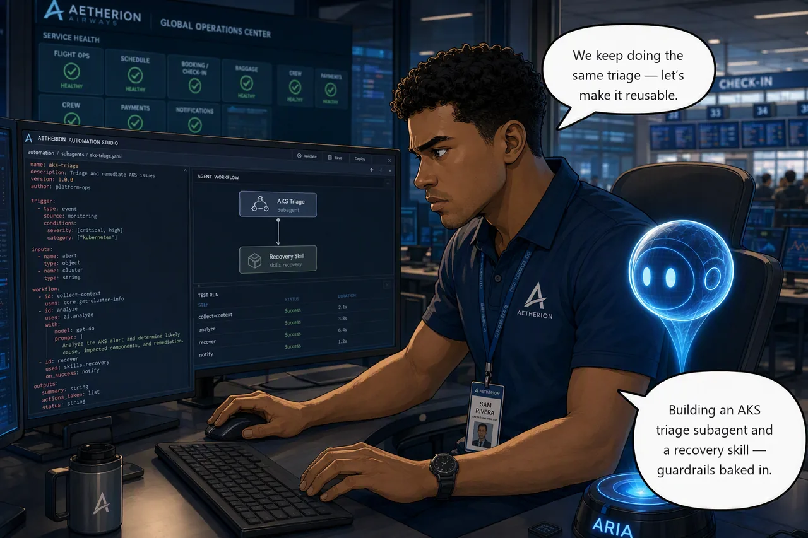

# Extra B · Engineer the Agent: Specialist Subagent and Reusable Skill

!!! abstract "Extra B · Optional extra"
    **Time:** ~45 min · **Run mode:** Review · **Access:** builder work, no incident to fix

    Do this if you finish early. Nothing later depends on it.

**Situation.** The platform is stable, which is the right time to invest in tooling. You have repeated the same
Kubernetes triage and the same crew query-path recovery. Both are candidates to make reusable.

**Mission.** Build an AKS specialist subagent **scoped to the tools it needs** (not everything), use it for an
investigation, then encode the crew recovery as a skill with its guardrails intact.

!!! example "Start this challenge"

    ```powershell
    ./scripts/start-challenge.ps1 B
    ```

    No fault is injected, so the board stays green while you build.

### Tasks

1. **Build the specialist.** Create an `aks-triage` subagent, scope it to its **eight tools**, verify what it got, then delegate a namespace-health investigation to it.
2. **Encode the skill.** Capture the Extra A crew recovery as a reusable skill and confirm it loads.
3. **Decide who owns the skill.** The specialist or the main agent, and why.

You do not type either definition from scratch. Both ship in your **lab clone** (not the application repo):

| What | File | Where it goes |
|---|---|---|
| The `aks-triage` subagent | `agents/aks-triage.agent.yaml` | The dialog's **YAML** tab |
| The crew recovery skill | `skills/crew-query-path-recovery/SKILL.md` | The SKILL.md editor |

Read them before you paste. The point is *why* these eight tools and not the other 46, and why the guardrails are
worded as they are.

{ .story-panel loading=lazy }

### Suggested prompt

!!! quote "Paste into the agent chat"
    Delegate this to your `aks-triage` subagent rather than handling it yourself. Triage pod status, events,
    rollout history and dependency health for the `aetherion` namespace, and return a scoped health assessment
    with likely causes and evidence. Tell me which agent produced the answer.

??? warning "Ask for the subagent by name"
    *"Act as my AKS specialist"* does **not** invoke it: the main agent just adopts the persona. *"Delegate this to
    your `aks-triage` subagent"* does, and you will see a **Parallel subagent execution** step in the thread.

### Success criteria

- The subagent exists and is **scoped to a deliberate tool set**. You verified through the API that `RunKubectlReadCommand` is present and `RunKubectlWriteCommand` is **absent**.
- You invoked it by name and its triage is genuinely useful.
- A skill captures the sanctioned recovery with its guardrails, and loads.
- You decided who owns the skill (the main agent, not the read-only specialist) and can say why.

!!! success "Verify your work"

    ```powershell
    ./scripts/check-challenge.ps1 B
    ```

    Nothing here changes the platform, so the check asks you to confirm what you built.

??? tip "Hints"

    - Decide the specialist's remit in one sentence first. A subagent that inherits every tool is a persona in a costume: its "read-only" line is only a request. **Tools** are enforced; **instructions** are advisory.
    - Derive the tool list from evidence: what an AKS investigation actually used in Challenges 2 and 3 and Extra A.
    - Encode *why not* in the skill. "Crew is slow, add replicas" would be actively harmful here.

??? question "Stuck? Step by step"

    ??? note "Task 1 · Build the specialist"
        **Builder → Agent Canvas → + Create subagent**. Name it `aks-triage`. Use the **YAML** tab, not the Form: four
        of the eight tools come from the built-in MCP server and **do not appear in the Form picker**, so a Form-only
        attempt silently builds a half-scoped specialist. Paste `agents/aks-triage.agent.yaml`.

        | Tool | Why |
        |---|---|
        | `RunKubectlReadCommand`, `RunAzCliReadCommands` | Pods, events, rollout history, configuration |
        | `system-mcp-monitor_monitor_metrics_query`, `…_resource_log_query`, `…_activitylog_list` | Metrics, container logs, platform changes |
        | `QueryLogAnalyticsSearch` | Workspace search when metrics are not enough |
        | `SearchIncidentKnowledge`, `SearchMemory` | Runbooks and earlier incidents |

        Left out on purpose: `RunKubectlWriteCommand` (**the one that matters**: the specialist can no longer change
        the cluster), `RunAzCliWriteCommands`, `UploadKnowledgeDocument`, scheduled-task tools.

        !!! warning "Selecting tools replaces the inherited set"
            It does not add to it, so the list must be complete. Without it the canvas shows
            `Inherits 46 tools · 38 skills`: identical to the main agent.

        **Verify what it got. Do not trust the dialog:**

        ```powershell
        $base = az resource show -g <resource-group> -n <agent-name> --resource-type Microsoft.App/agents `
          --api-version 2026-01-01 --query properties.agentEndpoint -o tsv
        $tok = az account get-access-token --resource https://azuresre.ai --query accessToken -o tsv
        (Invoke-RestMethod "$base/api/v2/agent/tools" -Headers @{ Authorization = "Bearer $tok" }).data |
          Where-Object enabled | Select-Object category, name | Sort-Object category, name
        ```

        `RunKubectlReadCommand` must be present and `RunKubectlWriteCommand` absent. Then delegate by name and judge it
        on one question: would this have sped up a real AKS incident?

    ??? note "Task 2 · Encode the skill"
        **Builder → Agent Canvas → + Create skill**. Name: `crew-query-path-recovery`. Two descriptions, two jobs:

        - **Description** (left panel, behind **Edit**): *when* to reach for it. For example: *"Use when crew scheduling is
          slow or timing out and the pods look healthy and underutilised: a saturated shared database, not a saturated
          workload."*
        - `description:` in the SKILL.md frontmatter: *what* it does.

        Select everything in the editor and replace it with the whole `skills/crew-query-path-recovery/SKILL.md`
        (this removes the placeholder). Leave **Tools** empty, then **Create**.

        Its guardrails are the point: diagnose which layer is saturated; repair the query path with the missing index;
        never delete or restart the database; do not scale the layer that is merely waiting; propose every write first.

    ??? note "Task 3 · Decide who owns the skill"
        A **subagent** is something you delegate to by name. A **skill** is a procedure the agent draws on. Built together
        does not mean owned together. Open `aks-triage` → **Skills**: left inherited it holds the crew skill. Select only
        `aks_general` and `diagnostic_cpu` so the crew skill falls away (selecting *overrides*; there is no "off").

        | Reason | Detail |
        |---|---|
        | **Remit** | Its instructions say *do not investigate the database*. This is a database query path |
        | **Capability** | It has no write tool, and the remedy is to **apply** an index |
        | **Ownership** | The main agent commands the whole board and holds the write tools |

        **A skill belongs to whichever agent has both the remit and the tools to execute it.**

        !!! warning "A skill does not fire on its own"
            In validation this skill did not activate during a live investigation of exactly its incident. Asked directly,
            the agent matched it correctly. **Name the skill** when you want it used.

### Reference

- [Create a subagent](https://learn.microsoft.com/en-us/azure/sre-agent/create-subagent)
- [Create a skill](https://learn.microsoft.com/en-us/azure/sre-agent/create-skill)

!!! success "That is every extra"
    You grounded the agent and built a specialist and a skill.

    [Back to the finish page →](finish.md){ .md-button .md-button--primary }
