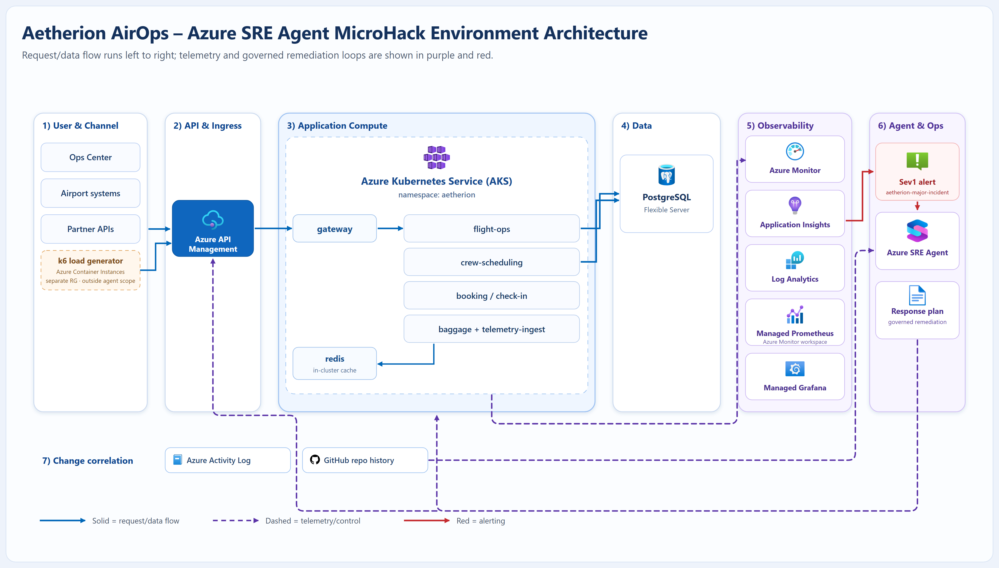

# Set up your environment

This is the only setup step. Your facilitator has already built the Aetherion AirOps
platform for you; one command attaches your laptop to it, then hands you straight to
Challenge 1.

!!! info "You do not delete anything"
    The environment lives in a shared subscription and your facilitator tears it down
    after the session. **Do not run `./scripts/99-teardown.ps1`.**

## 1. Install the required tools (Windows)

Setup is written for **Windows**. The scripts are PowerShell 7, so macOS and Linux
need `pwsh` installed and the `winget` step replaced with your own package manager.

| Tool | Minimum version | Notes |
|------|-----------------|-------|
| PowerShell | 7.0 | required |
| Azure CLI | 2.60 | required |
| kubectl | any recent | required |
| Git | any recent | required |
| GitHub CLI (`gh`) | any recent | optional, but the steps below and Challenge 6 give `gh` one-liners, and the Challenge 6 grader uses it to confirm your work instead of asking you |

```powershell
winget install --id Microsoft.PowerShell --exact --accept-source-agreements --accept-package-agreements
winget install --id Microsoft.AzureCLI --exact --accept-source-agreements --accept-package-agreements
winget install --id Kubernetes.kubectl --exact --accept-source-agreements --accept-package-agreements
winget install --id Git.Git --exact --accept-source-agreements --accept-package-agreements
winget install --id GitHub.cli --exact --accept-source-agreements --accept-package-agreements
```

After installs complete, restart your terminal so the commands are available on
PATH, and sign in to the GitHub CLI once with `gh auth login`.

!!! warning "Run every command in PowerShell 7 (`pwsh`)"
    Windows PowerShell 5.1 is the default on Windows and is **not** supported: the
    scripts stop with a version error. Start your session with `pwsh` and confirm
    with `$PSVersionTable.PSVersion` (must be 7.0 or later).

## 2. Get the two repositories

You use **two** repositories in this NanoHack. Keeping them straight matters:
one drives the hack, the other is the "production" application the agent
investigates.

| | What it is | You get it by | Used for |
|---|---|---|---|
| **Lab clone** | This workshop: challenges, scripts, runbooks, the subagent and skill files | `git clone` | Running `start-challenge` / `check-challenge`, and the `knowledge/` files in the optional Extra A |
| **Your app repo** | The Aetherion AirOps application source | **Use this template** | The repo you connect the **SRE Agent** to, and the one it writes to in Challenge 6 |

**a) Clone the lab repo.** It drives the hack (challenges + scripts):

```powershell
git clone https://github.com/abengtss-max/azure-sre-agent-nanohack.git
cd azure-sre-agent-nanohack
```

**b) Create your own copy of the application repo.** This is the Aetherion AirOps
*application* source that the Azure SRE Agent connects to for change correlation.
It is a **template repository**, so you get your own standalone copy in one click:

1. Open <https://github.com/abengtss-max/aetherion-airops-platform>
2. Click **Use this template** → **Create a new repository**.
3. Choose **your own account** as the owner, keep the name
   `aetherion-airops-platform`, and create it.

It is created **private**, which is correct — leave it that way. The agent reads
it through the Code Access connection you make in Challenge 1, not anonymously.

You'll connect the SRE Agent to **your copy** in Challenge 1.

??? tip "Why a template and not a fork"
    A fork would work, but GitHub turns **Issues off on every new fork** and
    Challenge 6 has the agent file the incident RCA as an issue. A template copy
    arrives with Issues already enabled, so that failure never happens.

    Creating it under your **personal account** also avoids the token-approval
    step in **c)** below.

    The copy starts with a single commit rather than the upstream history. Nothing
    in the hack depends on that history: Challenge 3 correlates change from the
    Kubernetes **rollout history**, and reads the repo only to answer *"what does
    the manifest declare"*.

**c) Create a GitHub Personal Access Token now.** Challenge 6 has the agent write
back to your repo — it files the incident RCA as an issue and opens a pull request
— and the GitHub MCP connector it uses for that accepts **a PAT only**. There is no
OAuth option on that connector.

Go straight to
**[github.com/settings/personal-access-tokens/new](https://github.com/settings/personal-access-tokens/new)**
(*Settings → Developer settings → Personal access tokens → Fine-grained tokens*)
and fill it in like this:

| Field | Set it to |
|---|---|
| **Token name** | `aetherion-microhack` |
| **Expiration** | **Custom** → tomorrow's date. The token only has to outlive today |
| **Resource owner** | your own account |
| **Repository access** | **Only select repositories** → `aetherion-airops-platform` |
| **Repository permissions → Contents** | **Read and write** — create a branch and commit |
| **Repository permissions → Pull requests** | **Read and write** — open the PR |
| **Repository permissions → Issues** | **Read and write** — file the RCA |

Click **Generate token** and **copy it now** — GitHub shows it once. Keep it in
your password manager until Challenge 6.

Prefer a classic token? **[github.com/settings/tokens/new](https://github.com/settings/tokens/new)**
with the top-level **`repo`** scope works too.

## 3. Check you have access

Your facilitator has already built your Aetherion environment. You were assigned a
**resource group** (for example `rg-aetherion-nanohack-07`) in a shared subscription,
and you have access to that resource group and its paired `-loadgen` group only.

- Your **resource group name**, and the subscription it is in, from your facilitator.
- This repository cloned locally and opened in VS Code.

```powershell
az login
az account set --subscription "<subscription-id>"
```

## 4. Attach to your environment

You do **not** provision anything. Run this once, with the resource group you were
given. It reads your environment and prepares the local files the challenge
scripts need:

```powershell
./scripts/attach-environment.ps1 -ResourceGroup <your-resource-group>
```

It prints your Ops Center and Grafana addresses and **your alert name**. Note these two:

| You need | Where | Why |
|---|---|---|
| **Resource group name** | Challenge 1 | Scope the agent to **your** group only |
| **Alert name** (etherion-major-incident-xxxxxx) | Challenge 4 | Your response plan must filter on it, because other attendees in this subscription have look-alike alerts |

You can print the alert name again at any time:

```powershell
(Get-Content ./scripts/.env.aetherion.json | ConvertFrom-Json).incidentAlertName
```

!!! tip "Use the wait. Read about the airline."
    Read **[Meet Aetherion](overview.md)** now: who you are, what the airline does, and
    who you'll be working with. You'll arrive at Challenge 1 knowing what you're
    looking at.

!!! warning "Work only in your own resource group"
    Other attendees share this subscription. Never scope the agent, run a script, or
    change a resource in a resource group that is not yours.

!!! danger "Choose the Azure OpenAI model provider when you create the agent"
    A regulatory requirement: **Azure OpenAI** (the GPT / ChatGPT models) is covered by EU Data Boundary
    commitments. **Anthropic** is not (data may be processed in the United States). Challenge 1 shows where.

??? tip "If attach fails"
    - **Resource group not found:** check the exact name and that
      `az account show` is the subscription your facilitator gave you.
    - **No `aetherion-infra-*` deployment:** your environment is not finished yet; tell
      your facilitator.
    - **Cannot read the APIM key or AKS credentials:** you are missing access on your
      resource group; tell your facilitator.
    - **Already attached:** add `-Force` to replace the local state.

## 5. What gets deployed

[{ .arch-diagram loading=lazy }](../assets/architecture/aetherion-architecture.png)

*Request/data flow runs left to right (solid blue); telemetry and control flow to
observability and the Azure SRE Agent (dashed purple); alerting is shown in red.
**Click the diagram to open it full size.** See the [full architecture reference](../reference/architecture.md) for the deep dive.*

| Layer | Resources |
|-------|-----------|
| Edge | Azure API Management (subscription-key auth, rate limiting) |
| Compute | AKS cluster `aetherion-aks`, namespace `aetherion`: 6 microservices + in-cluster Redis cache |
| Data | Azure Database for PostgreSQL Flexible Server · in-cluster Redis cache |
| Observability | Application Insights `aetherion-appi` · Log Analytics `aetherion-law` · Azure Managed Grafana |
| Agent | Azure SRE Agent `aetherion-sre-agent` |

## 6. Confirm it's healthy, then start

When attach finishes, open the Operations Center address it printed. You're ready
when it loads with all tiles green.

Check it on its own at any time:

```powershell
./scripts/04-validate.ps1
```

[Meet Aetherion →](overview.md){ .md-button .md-button--primary }

---

<details markdown="1"><summary>What each component is for (reference)</summary>

| Component | Purpose | Where |
|-----------|---------|-------|
| Operations Center GUI | Live service health, risk gauge, flight map, incidents, business impact | `https://sreagenthack-XXXXX.<region>.cloudapp.azure.com/` |
| API front door | Partner/mobile entry point, subscription-key auth, rate limiting | `<apim-gateway-url>/aetherion/api/status` |
| PostgreSQL database | System of record for bookings, crews, and telemetry writes | Azure Database for PostgreSQL Flexible Server |
| Redis cache | Low-latency cache for booking/check-in read patterns | In-cluster `redis` container in AKS |
| Dashboards | Metrics, traces, log visualizations | Azure Managed Grafana |
| App telemetry | Requests, dependencies, exceptions, app map | Application Insights `aetherion-appi` |
| Logs | Container and node logs/metrics | Log Analytics `aetherion-law` |
| Compute | All microservices | AKS `aetherion-aks`, namespace `aetherion` |
| Load generator | Produces synthetic traffic during the workshop | Azure Container Instance in a separate resource group (not monitored by the agent) |
| Change history | Resource and deployment changes | Azure Activity Log + GitHub repo |
| Azure SRE Agent | Investigate, plan, and remediate with approval or bounded autonomy | Azure portal → `aetherion-sre-agent` |

Microservices: `gateway`, `flight-ops`, `crew-scheduling`, `booking`, `baggage`,
`telemetry-ingest`. Synthetic workshop traffic is generated externally by the load
generator (see the table above).

</details>

